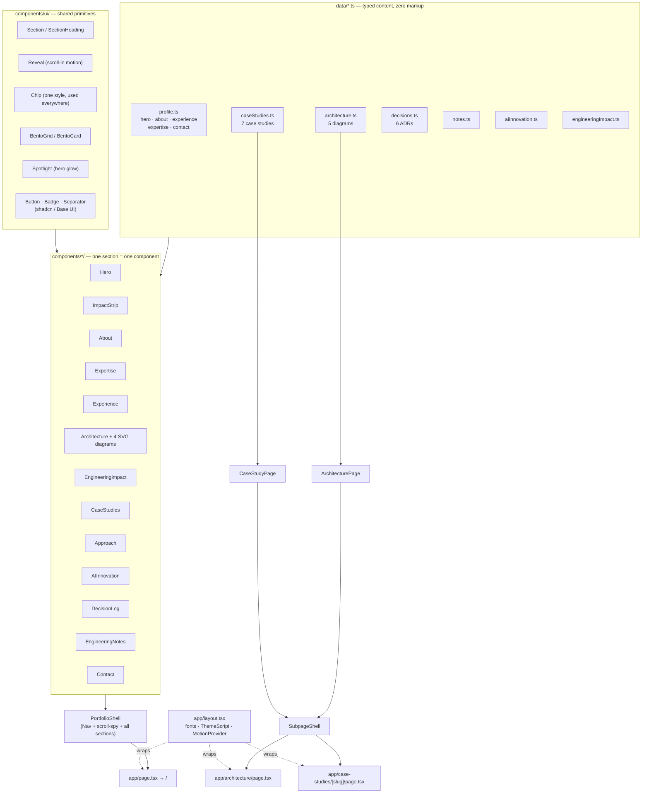

# Mohammad Shadmaan Asif — Portfolio

A single-page portfolio for a Staff Software Engineer, built with Next.js (App Router) and
React. The site's copy — roles, metrics, case studies, architecture write-ups — lives in
`data/*.ts` and is rendered through a small set of shared UI primitives, so the content and the
presentation layer stay largely independent of each other. The exceptions are listed under
[Content model](#content-model).

## Requirements

- **Node.js 20+** (developed and verified on 20.19.5)
- **pnpm** (pinned via `packageManager` in `package.json`; the lockfile is `pnpm-lock.yaml`)

## Tech stack

| Layer | Choice | Version range | Why |
| --- | --- | --- | --- |
| Framework | **Next.js** (App Router) | `^15.0.0` | Static generation for the homepage and every case-study page (`generateStaticParams`), file-based routing for `/architecture` and `/case-studies/[slug]`. |
| UI library | **React** / **React DOM** | `^19.0.0` | Server Components by default (App Router); client components are opted in explicitly (`"use client"`) only where interactivity is needed — nav, theme toggle, scroll-spy, motion. |
| Language | **TypeScript** | `^5.6.0` | Every content shape (`HeroContent`, `ExperienceEntry`, `CaseStudy`, …) is a typed interface in `data/`, so a content edit that breaks a component's expectations fails at build time, not in the browser. `strict` mode is on. |
| Styling | **Tailwind CSS v4** | `^4.3.3` (`@tailwindcss/postcss` `^4.3.3`) | Utility classes generated straight from CSS custom properties (`@theme inline` in `app/globals.css`) — no separate JS theme config file, no CSS Modules. |
| Component primitives | **shadcn/ui** (`base-nova` style) on **Base UI** | `shadcn ^4.21.0`, `@base-ui/react ^1.8.0` | `Button`, `Badge`, `Separator` in `components/ui/` are scaffolded via the `shadcn` CLI and generated against [Base UI](https://base-ui.com) — confirmed by reading each file: they import from `@base-ui/react/*`, not `@radix-ui/*`. |
| Motion | **Framer Motion** | `framer-motion ^13.4.4` | Scroll-triggered reveals (`components/ui/reveal.tsx`) and count-up metrics, wrapped in a single `MotionConfig reducedMotion="user"` provider in the root layout so every animation site-wide respects the OS-level reduced-motion setting automatically. |
| Icons | **Lucide** | `lucide-react ^1.48.0` | Everywhere except two icons Lucide doesn't ship (GitHub and LinkedIn's brand marks were dropped from the library) — those two are small hand-written SVGs in `components/icons/BrandIcons.tsx` rather than pulling in a second icon package. |
| Fonts | **Geist** (sans) + **IBM Plex Mono** (mono) | via `next/font/google` | Geist for body/headings, IBM Plex Mono for the technical/label voice (kickers, stack tags, ADR codes) — self-hosted by Next.js, no layout shift, no external font request. |
| Utilities | `class-variance-authority`, `cn`, `tw-animate-css` | `^0.7.1`, `^0.4.0`, `^1.4.0` | Variant styling for the shadcn primitives (`cva`), class-name merging (`cn`, re-exported from `lib/utils.ts`), and Tailwind-native `animate-*` utilities used by a couple of micro-interactions. |

No CSS Modules, no global CSS framework beyond Tailwind, no state-management library — the only
client-side state in the app is the active scroll-spy section, the theme toggle, and the
count-up-on-scroll animations, all handled with plain React hooks.

**Known unused dependencies:** `@radix-ui/react-separator` and `@radix-ui/react-slot` are still
listed in `package.json` (pulled in transitively when the shadcn primitives were first scaffolded)
but nothing in `components/` or `app/` imports `@radix-ui/*` — grepped and confirmed empty. Safe to
remove; left in place here only because removing dependencies wasn't in scope for this doc pass.

## Architecture



**Reading the diagram:** content (`data/`) and presentation (`components/ui/`) are both inputs to
the section components; nothing in `data/` imports React, and nothing in `components/ui/` knows
about Mohammad's resume. `PortfolioShell` composes all thirteen sections into the homepage;
`SubpageShell` provides the same header/footer chrome for the two dedicated routes
(`/architecture` and `/case-studies/[slug]`), which go deeper on the same diagrams and case
studies than the homepage cards do.

## Project structure

```
app/
  layout.tsx              Root layout — fonts, <ThemeScript>, <MotionProvider>
  page.tsx                Homepage — renders <PortfolioShell>
  globals.css              Design tokens (light + dark), Tailwind import, base styles
  architecture/page.tsx    /architecture — full diagram deep-dive
  case-studies/[slug]/     /case-studies/<slug> — one page per case study (SSG)

components/
  ui/                      Design-system primitives (Section, Chip, BentoGrid, Reveal, Spotlight,
                            Button/Badge/Separator from shadcn)
  icons/                   Hand-written brand SVGs (GitHub, LinkedIn)
  Nav/, PortfolioShell/    Homepage shell + scroll-spy navigation
  SubpageShell/            Header/footer chrome shared by the two dedicated routes
  Hero/, About/, Expertise/, Experience/, Architecture/, EngineeringImpact/,
  CaseStudies/, Approach/, AIInnovation/, DecisionLog/, EngineeringNotes/, Contact/
                            One folder per homepage section
  ArchitecturePage/        Body of /architecture
  ThemeScript.tsx          Blocking inline script — sets the dark class before first paint
  ThemeToggle.tsx          Light/dark toggle button

data/
  profile.ts               Hero, about, experience, expertise, headline stats, contact
  architecture.ts           The 5 architecture diagrams (id, copy, ADR-style stages)
  caseStudies.ts            The 7 case studies
  decisions.ts               The 6 engineering decision log (ADR) entries
  notes.ts, aiInnovation.ts, engineeringImpact.ts

lib/utils.ts                cn() — class-name merging, re-exported from the `cn` package
```

## Design system

- **Tokens, not hard-coded colors.** Every color is a CSS custom property on `:root` /
  `.dark` in `app/globals.css` (`--background`, `--foreground`, `--brand`, `--border`, …),
  exposed to Tailwind as utilities (`bg-background`, `text-brand`, …) through a single
  `@theme inline` block. Changing the palette means editing `globals.css`, not hunting through
  components.
- **One accent color**, used deliberately: active nav state, links, primary buttons, the one
  highlighted box in each architecture diagram, metric bars. Restrained on purpose — see the
  brief this was built against.
- **Dark mode is class-based** (`.dark` on `<html>`), not `prefers-color-scheme`-only, so the
  toggle in the nav can override the OS setting. `ThemeScript` runs as a blocking inline script
  in `<head>` and sets the class before React hydrates, so there's no flash of the wrong theme.
- **One chip style everywhere.** Tech tags in the hero, the experience timeline, the expertise
  grid, and case-study cards all render through `components/ui/chip.tsx` — same height (24px),
  padding, and mono type scale in every context, rather than each section inventing its own
  tag styling.
- **Spacing is set in three shared places, not per section.** `components/ui/section.tsx` owns the
  vertical rhythm between sections (48px top/bottom on mobile, 72px from `sm` up),
  `components/ui/section-heading.tsx` owns the 40px gap between a heading and its content, and
  `--header-height` in `globals.css` is the one header height that the nav, the Hero's
  `min-h`, and `scroll-margin-top` all read, so anchor jumps land flush under the header.
  `components/ui/eyebrow.tsx` is the shared section label.
- **Motion is centralized.** `MotionProvider` (root layout) sets `reducedMotion="user"` once for
  the whole app; individual sections just use `<Reveal>` and never have to think about
  `prefers-reduced-motion` themselves.

## Content model

Section components take typed props from `data/` and render them. To change what the site says,
edit the relevant file in `data/`; to change how it looks, edit the component. Three things are
hard-coded in components rather than in `data/`: the SVG diagram labels
(`components/Architecture/*Diagram.tsx`), section headings that state a count (for example
"Seven initiatives" and "Six decisions"), and the page metadata in `app/layout.tsx` — keep them in
sync with the data when it changes.

The architecture diagrams stay honest through one flag: `data/architecture.ts` marks a diagram
`conceptual: true` when the resume describes a pattern but not its exact wiring (currently the SDK
layer, delivery pipeline, and state/real-time data flow), and the UI shows that as a visible badge
instead of presenting every diagram with the same authority. The options and trade-offs fields on
architecture entries, case studies, and ADRs are retrospective reasoning rather than resume facts.

## Getting started

```bash
pnpm install
pnpm dev      # next dev   — local dev server at http://localhost:3000
pnpm build    # next build — production build; runs the TypeScript compiler and ESLint as part of the build, so a type error or lint error fails the build
pnpm start    # next start — serve the output of `pnpm build`
pnpm lint     # next lint  — ESLint only, without a full build
```

There are no environment variables and no `.env` file — every value the site renders comes from
`data/*.ts`, not from runtime configuration.
